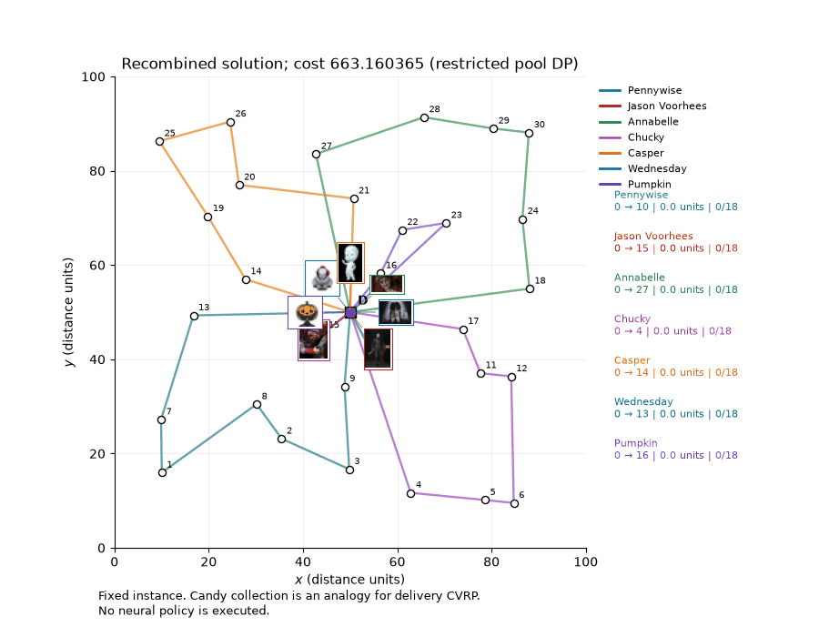

# Halloween CVRP

A Halloween-themed Python simulation of the capacitated vehicle routing problem on a small instance, built for a graduate seminar presentation at Aalto University. Seven collectors gather candy from 30 houses.



It illustrates the decompose-and-recombine idea of the hybrid method by Fitzpatrick, Ajwani and Carroll (2024), then compares the result with exact solutions from HiGHS.

**No neural network is trained or run.** Candidate routes come from classical methods, and the Attention Model and POMO figures are teaching illustrations only. These results don't reproduce the paper's experiments.

## Results

Instance: 30 customers, total demand 84, vehicle capacity 18, at most 7 vehicles.

| Solution | Cost | Status |
| --- | ---: | --- |
| Clarke-Wright savings, 7 routes | 673.04 | Heuristic |
| After set partitioning on the route pool, 7 routes | 663.16 | Optimal for the pool only |
| Exact MILP, exactly 7 routes | 650.97 | Proven optimal by HiGHS |
| Exact MILP, at most 7 routes (5 used) | 638.82 | Time limit reached, not proven optimal |

## Run it

Python 3.11 or newer:

```bash
python3 -m venv .venv
.venv/bin/python -m pip install -r requirements.txt
.venv/bin/python 03_subproblem.py --show --portraits
```

In an animation window, press Space to pause, + or - to change speed, and R to restart. Remove `--portraits` for the plain version.

| Script | What it shows |
| --- | --- |
| `01_instance.py` | The instance |
| `02_clarke_wright.py` | Clarke-Wright merges and routes |
| `03_subproblem.py` | Subproblem selection and recombination |
| `04_feasibility_mask.py` | Capacity feasibility masks |
| `05_pomo_illustration.py` | Multiple starts, as an illustration only |
| `06_green_resources.py` | Fuel and time resources, as an illustration only |
| `07_comparison.py` | Comparison with the exact solutions |

To export every figure and animation to `outputs/`, then check them:

```bash
.venv/bin/python run_all.py --export --portraits
.venv/bin/python verify.py
```

## What is recomputed

The scripts recompute Clarke-Wright, the centroid selection, the pool partitioning, the feasibility masks and the resource interpolation. Candidate generation and the exact MILP solutions are loaded from saved runs in `data/`, and the MILP solving code isn't included here.

## Paper and sources

This project is based on the following paper, which is the work of its authors:

> James Fitzpatrick, Deepak Ajwani, Paula Carroll. *A scalable learning approach for the capacitated vehicle routing problem*. Computers & Operations Research 171, 106787 (2024). https://doi.org/10.1016/j.cor.2024.106787

This repository is an independent student illustration, not the authors' code. See [SOURCES.md](SOURCES.md) for all references.

## License

The code and the teaching instance are under the [MIT License](LICENSE). The character images are not covered: they belong to their rights holders, and any of them will be removed on request.
